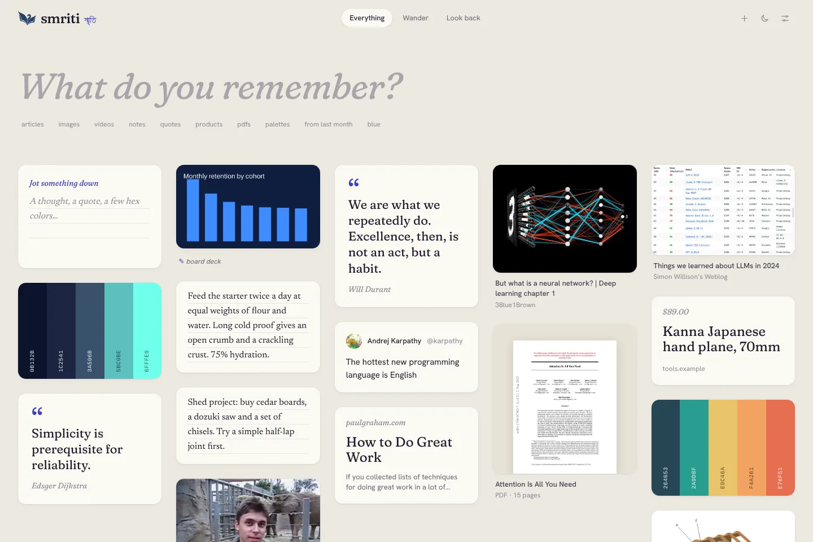
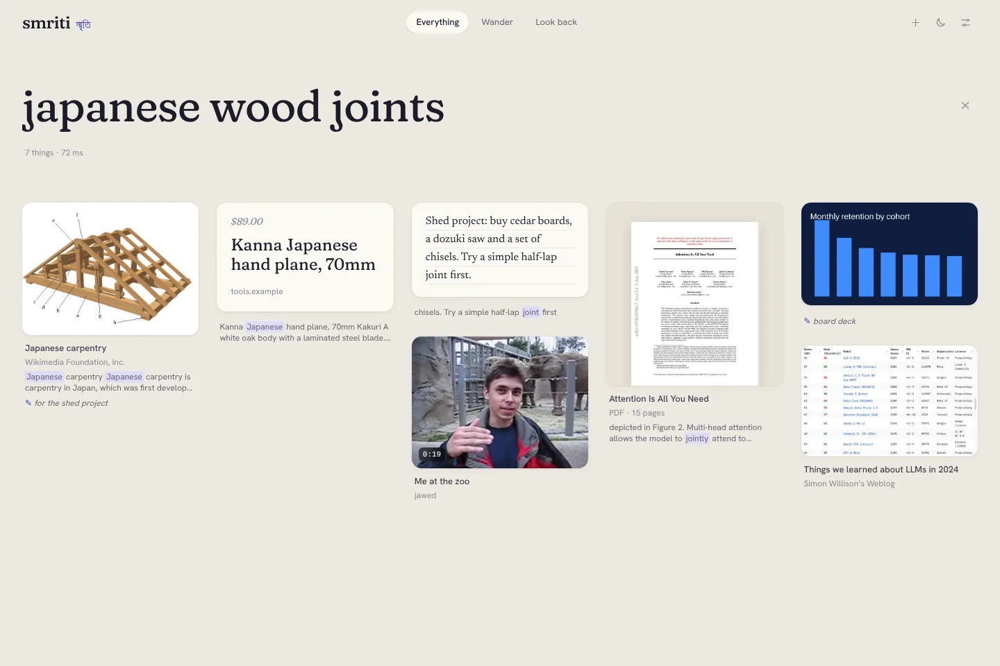
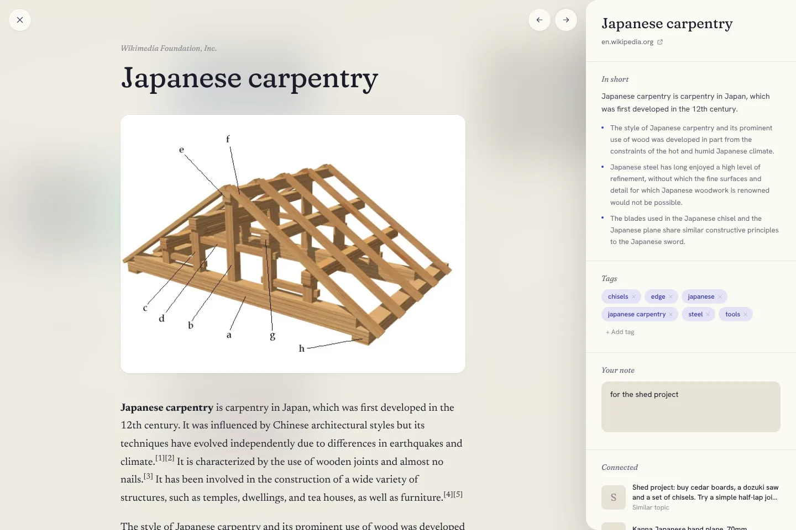
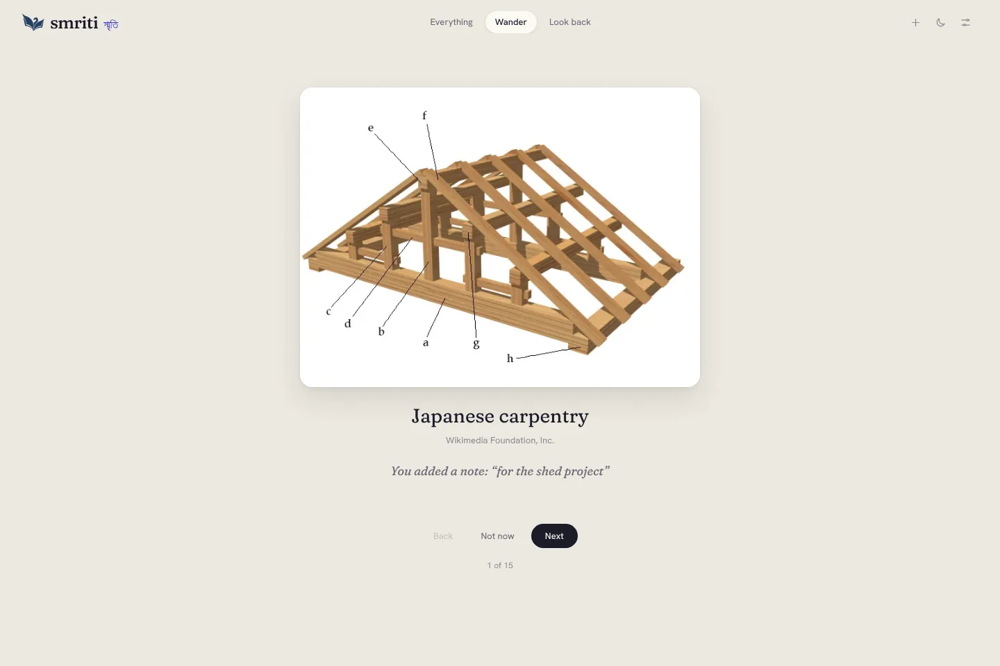
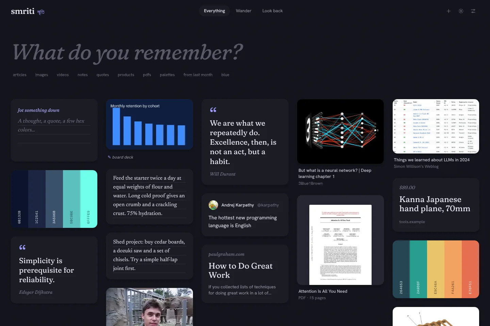
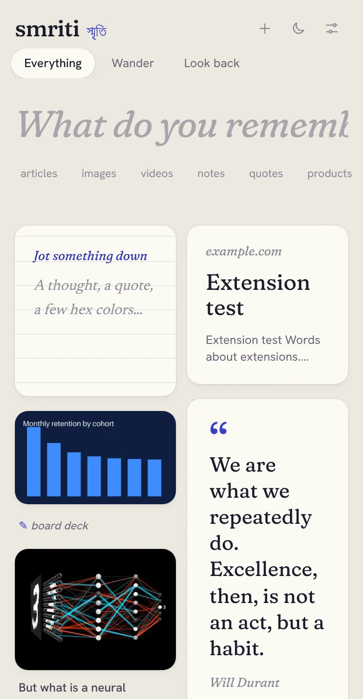

<p align="center">
  
</p>

<p align="center">
  Links, articles, tweets, videos, PDFs, images, quotes and notes, found again by what they were about.<br>
  Self-hosted. One user. Nothing leaves your machine unless you say so.
</p>

<p align="center">
  
</p>

Smriti (স্মৃতি) means "memory". Most bookmark tools make you file things away, then never show them to you again. Smriti asks for nothing at save time and does the work afterwards: it reads every page, archives it, works out what it is about, and brings it back when it becomes relevant.

## What it does

**Save in one move.** Click the browser extension, share from your phone, forward an email, drag a file onto the page, paste anywhere, or type in the note card at the top of the grid. The card appears at once and fills in over the next few seconds.

**Keeps the real thing.** Articles are read and cleaned of chrome, YouTube videos get their transcript and chapters, PDFs their text (with OCR for scans), tweets their thread, products their price. Every page is archived as a self-contained copy, so a dead link loses nothing.

**Finds vague things.** Type what you remember, not what you filed it under.

<p align="center">
  
</p>

Keyword, semantic, image and color search run together and their results are merged. Filters are read out of plain language and shown as chips you can remove:

| You type | Smriti reads |
| --- | --- |
| `blue charts from twitter last spring` | text "charts", color blue, source twitter.com, March to May |
| `the long read on japanese carpentry` | articles about japanese carpentry |
| `pdfs since 2024 with notes` | PDFs, saved from 2024 on, that you annotated |
| `#design palettes` | color palettes tagged design |

**Opens without losing your place.** An item opens full screen over the grid: the content on the left, and on the right a short summary, tags, your note and what it connects to. Arrow keys move to the next item.

<p align="center">
  
</p>

**Brings things back.** "Remember these?" on the home page, connected items in every item view, a weekly **Look back**, and **Wander**, which walks you through your library one item at a time. Each one says why it came back: *"Related to the 3 articles on retrieval you saved this week"*, *"You added a note: for the shed project"*, *"You haven't opened this since March 2026"*.

<p align="center">
  
</p>

**Feels like paper.** Indigo ink on a warm, faintly grained page, set in Fraunces. There is a dark mode, it installs as an app on your phone, and it works from the keyboard (press <kbd>?</kbd>).

<p align="center">
  
  &nbsp;
  
</p>

## Get started

You need Docker.

```sh
git clone https://github.com/azmainadel/smriti && cd smriti
cp .env.example .env
# Fill in SMRITI_OWNER_SECRET and SMRITI_SIGNING_KEY. `openssl rand -hex 32` makes good ones.
docker compose up -d --build
```

Open http://localhost:3000 and enter your owner secret. The first screen offers to import your browser bookmarks, Pocket or Raindrop export. The first save downloads a small embedding model (about 130 MB), so give it a moment.

Stop it with `docker compose stop`, or `docker compose down` to remove the containers. Your library lives in Docker volumes and survives both; `docker compose down -v` deletes it.

### Capture from everywhere

| From | How |
| --- | --- |
| Chrome or Firefox | Load the [`extension/`](extension/README.md) folder, paste a token from Settings → Devices. Click, or <kbd>Alt</kbd>+<kbd>Shift</kbd>+<kbd>S</kbd>. |
| Android | Install the web app from the browser menu. Smriti appears in the share sheet. |
| iPhone | A two-step Shortcut, described in [docs/capture.md](docs/capture.md). |
| Email | Point your mail provider's inbound webhook at `/inbound/email/<secret>`. |
| Terminal | `smriti save https://…`, `smriti import bookmarks.html`, `smriti search "…"` |

### Smarter summaries and tags (optional)

Out of the box Smriti writes summaries and tags with plain heuristics, so it works with no AI model at all. For better ones, run a small local model:

```sh
docker compose --profile ollama up -d
docker compose exec ollama ollama pull qwen2.5:3b-instruct
# set SMRITI_LLM_PROVIDER=ollama in .env, then: docker compose restart api worker
```

Any OpenAI-compatible API works too, chosen per step in Settings, which labels any step that sends data off your machine. See [docs/models.md](docs/models.md).

## How it works

```
 extension ─┐
 share sheet┤                 ┌──────────────┐     ┌──────────────────┐
 email ─────┼──► FastAPI ────►│  Postgres 17 │◄────│  workflow runner │──► fetch, extract,
 CLI ───────┤   saves in a    │  + pgvector  │     │  (SKIP LOCKED    │    snapshot, enrich,
 web app ◄──┘   few ms        │  + jobs      │     │   queue)         │    index
     ▲                        └──────────────┘     └──────────────────┘
     └──── server-sent events: cards fill in live          │
                                   files ◄────────────────┘ originals, archives, images
```

Saving writes one row and returns. A background worker runs six versioned, idempotent steps: classify, fetch, extract, snapshot, enrich and index. A crash or retry never leaves a half-saved item, and bumping a step's version re-runs just that step for old items. The API pushes each step to the browser, which is why cards fill in while you watch. The details are in [docs/architecture.md](docs/architecture.md).

| Part | Built with |
| --- | --- |
| Web | Next.js 15, TypeScript, Tailwind v4, Ark UI, Motion, TanStack Query |
| API and worker | FastAPI, Python 3.12, Pydantic v2, SQLAlchemy 2, Alembic |
| Search | Postgres full-text, pgvector HNSW, CLIP image vectors, CIELAB color matching, reciprocal rank fusion |
| Models | One adapter over local ONNX models (fastembed), Ollama and OpenAI-compatible APIs, cached by input hash |
| Storage | Postgres with pgvector; files on a volume or any S3-compatible store |

## Numbers

Measured on a 4 vCPU cloud container. [docs/benchmarks.md](docs/benchmarks.md) has the commands to reproduce them.

| | |
| --- | --- |
| Search, 50,000 items | p50 56 ms, p95 85 ms |
| Search quality, seed set of 70 queries | recall@10 1.00, MRR 0.84, checked in CI on every change |
| Home page | 217 KB of JavaScript (compressed), 171 KB of fonts, card images sized to the card; largest paint under 0.4 s |
| Memory with local models loaded | API 635 MB, worker 845 MB |

The seed query set is small and written by hand. It guards against ranking regressions; it does not prove quality on a real library.

## Development

```sh
# API and worker (needs Postgres with pgvector)
cd api
uv sync --extra ocr
createdb smriti && createdb smriti_test
uv run smriti migrate
uv run smriti serve --reload      # http://localhost:8000/docs
uv run smriti work
uv run pytest

# Web
cd web
npm install
npm run dev                       # http://localhost:3000
npm run gen:api                   # regenerate API types after changing the API
```

```
api/         API, workflow runner, CLI, migrations, tests, search eval set
web/         The web app and PWA
extension/   Browser extension for Chrome and Firefox
docs/        Architecture, models, capture, deployment, benchmarks, status
```

## Status

Smriti is a personal project and a work in progress. Saving, extraction, enrichment, search, resurfacing and every capture path are built and tested. [docs/status.md](docs/status.md) lists what is partial or missing, honestly.

## License

MIT. Fraunces is included under the SIL Open Font License ([web/src/fonts/OFL-Fraunces.txt](web/src/fonts/OFL-Fraunces.txt)).
